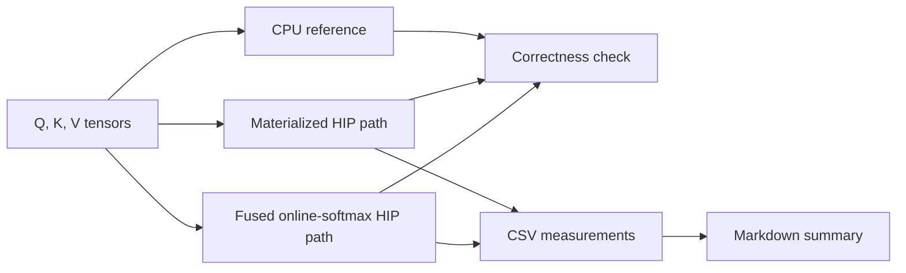

# Wave Attention Lab

A small, inspectable HIP/C++ laboratory for optimizing scaled dot-product
attention on AMD GPUs. The first target is an AMD Radeon RX 9070 XT (RDNA 4,
`gfx1201`).

This is deliberately a kernel project, not a Python wrapper around a framework.
It exposes the numerical reference, GPU kernels, memory tradeoffs, benchmark
method, and profiler commands needed to discuss performance with evidence.



## What is implemented

| Path | Kernels | Score workspace | Purpose |
| --- | ---: | ---: | --- |
| CPU reference | n/a | `O(N)` | Stable correctness oracle and portable CI |
| Materialized HIP | 3 | `O(B * H * N^2)` | Clear performance baseline |
| Fused HIP | 1 | `O(1)` | Streaming, numerically stable online softmax |

Both GPU paths support causal and non-causal attention. The benchmark reports
kernel time, estimated TFLOP/s, logical bandwidth, workspace bytes, an output
checksum, and optional error against the CPU oracle. Inputs are deterministic.

The current kernels use FP32 and prioritize clarity and measurement. The next
optimization steps are intentionally recorded in
[docs/optimization-notes.md](docs/optimization-notes.md) rather than presented
as completed work.

## Quick start: portable CPU build

You need CMake 3.25+ and a C++17 compiler.

```bash
cmake -S . -B build -DWAVE_ENABLE_HIP=OFF -DCMAKE_BUILD_TYPE=Release
cmake --build build --config Release --parallel
ctest --test-dir build -C Release --output-on-failure
./build/wave_bench --backend cpu --sequence 128 --dimension 64
```

On a Visual Studio generator, the executable is normally at
`build/Release/wave_bench.exe`.

## RX 9070 XT HIP build

For a Windows host, use Ubuntu 22.04 or 24.04 under WSL and follow AMD's current
ROCm-on-WSL installation instructions. The card's compiler target is `gfx1201`.
See [docs/setup-rx9070xt.md](docs/setup-rx9070xt.md) for the host checklist.

```bash
cmake -S . -B build -G Ninja \
  -DWAVE_ENABLE_HIP=ON \
  -DCMAKE_BUILD_TYPE=Release \
  -DCMAKE_HIP_ARCHITECTURES=gfx1201 \
  -DCMAKE_PREFIX_PATH=/opt/rocm
cmake --build build --parallel
ctest --test-dir build --output-on-failure

./build/wave_bench \
  --backend hip --algorithm fused \
  --batch 1 --heads 8 --sequence 256 --dimension 64 \
  --warmup 10 --iterations 100 --verify
```

Run a repeatable sweep and summarize it:

```bash
python3 scripts/run_sweep.py --executable ./build/wave_bench --output out/rx9070xt.csv
python3 scripts/summarize.py out/rx9070xt.csv --output out/RESULTS.md
```

## Profiling

Start with a runtime trace to separate dispatch, copies, and kernels:

```bash
rocprofv3 --runtime-trace --output-format csv -- \
  ./build/wave_bench --backend hip --algorithm fused \
  --heads 8 --sequence 1024 --dimension 64 --warmup 2 --iterations 10
```

Then list the counters available on the installed GPU before choosing a counter
set:

```bash
rocprofv3-avail list --pmc
```

Do not combine arbitrary counters without checking that the hardware can collect
them together. The profiling plan and hypotheses are in
[docs/optimization-notes.md](docs/optimization-notes.md).

## Repository map

```text
include/wave/attention.hpp   Public API and benchmark result schema
src/attention_cpu.cpp        Stable CPU reference and comparison helpers
src/attention_hip.hip        Materialized and fused HIP implementations
src/main.cpp                 Reproducible benchmark CLI and CSV writer
tests/attention_tests.cpp    CPU semantic tests
scripts/run_sweep.py         Standard experiment matrix
scripts/summarize.py         CSV-to-Markdown comparison report
docs/                        Setup, design, and optimization record
```

## Honest scope

This repository does not yet claim to beat rocBLAS, hipBLASLt, Composable Kernel,
or production FlashAttention. Its value is a reproducible optimization loop:
define a baseline, preserve semantics, measure on real AMD hardware, inspect the
bottleneck, make one change, and publish the result. See the roadmap for the
work that would turn the educational fused kernel into a competitive operator.

## License

MIT

