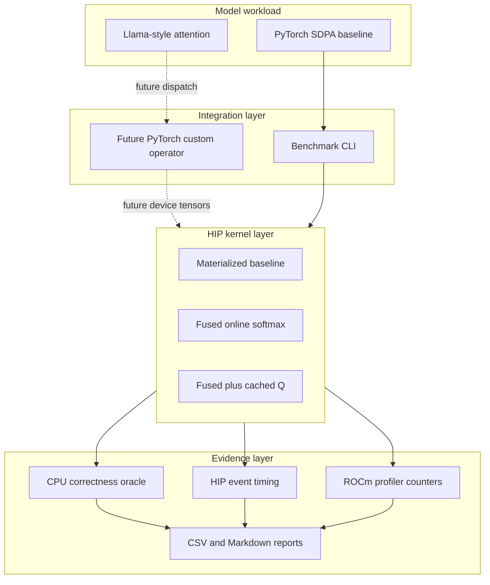
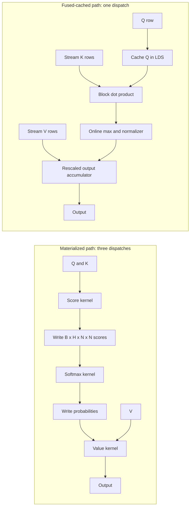
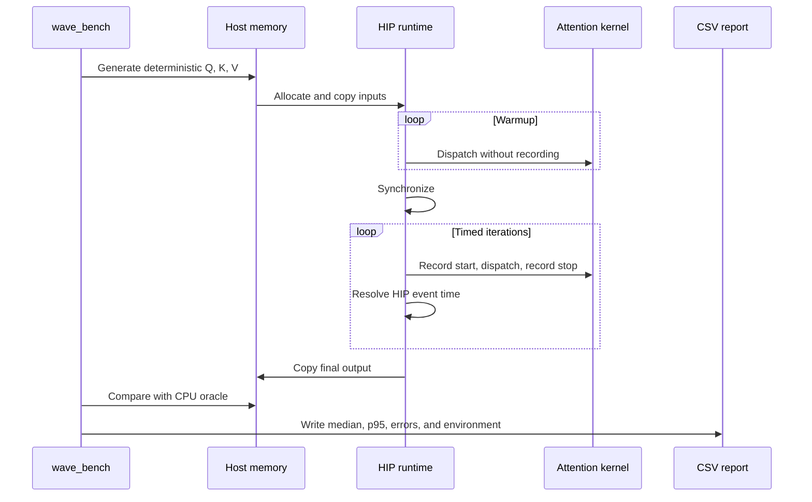
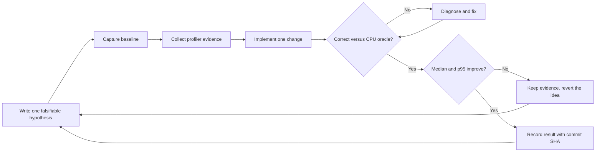
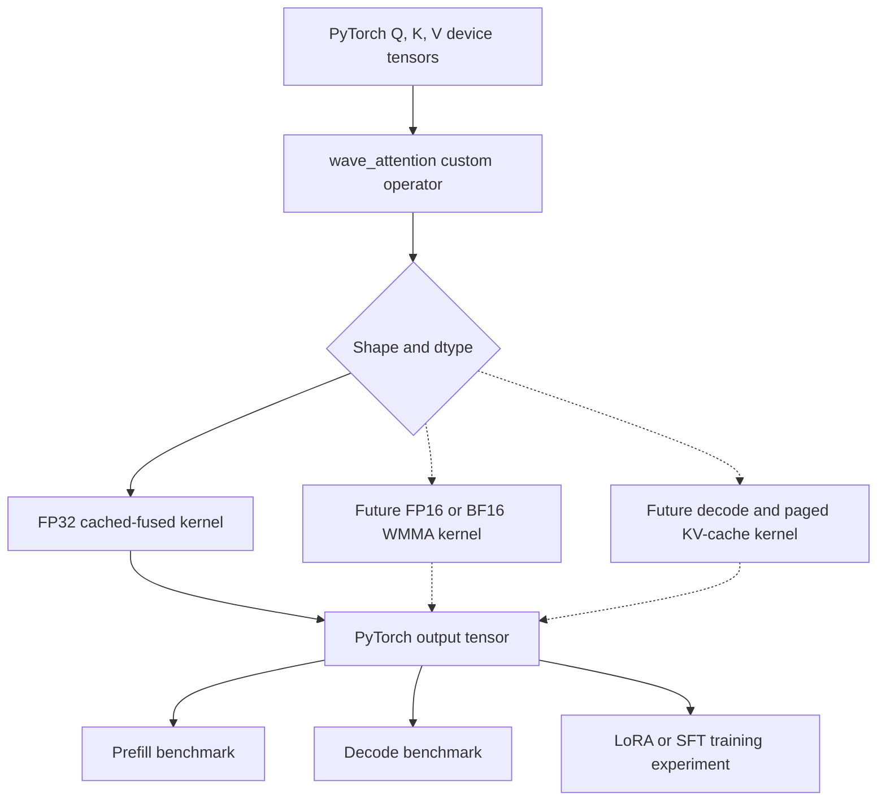

# Architecture

This page shows how the repository grows from a kernel experiment into an
end-to-end AMD attention engineering project. Solid boxes are implemented;
dashed boxes describe the next integration boundary.

## System layers

## Kernel data flow

The materialized path is intentionally simple, but its intermediate grows with
`N^2`. The fused paths keep only the running softmax state and output
accumulator. `fused-cached` additionally removes repeated global reads of Q.

## Online softmax state

```mermaid
stateDiagram-v2
    [*] --> Empty: m = -inf, l = 0, o = 0
    Empty --> ReadScore: load K tile and compute x
    ReadScore --> Rescale: m_new = max(m, x)
    Rescale --> Normalize: alpha = exp(m - m_new)
    Normalize --> Accumulate: beta = exp(x - m_new)
    Accumulate --> ReadScore: l = alpha*l + beta; o = alpha*o + beta*V
    Accumulate --> Finalize: all keys consumed
    Finalize --> [*]: output = o / l
```

Subtracting the running maximum keeps exponentials bounded. When a new maximum
appears, the previous denominator and output accumulator are rescaled before
the new value is added.

## Benchmark lifecycle

Allocation and host-device transfer are deliberately outside the timing window.
Each timed iteration produces a sample, allowing median and tail latency to be
reported rather than hiding variation inside one aggregate measurement.

## Optimization loop

This loop is the central artifact of the project. A fast number without its
source revision, environment, correctness result, and profiler explanation is
not accepted as an optimization result.

## Target PyTorch and LLM path

The custom operator comes after device-level evidence. That order keeps
framework overhead from obscuring kernel behavior while the algorithm is still
changing.

