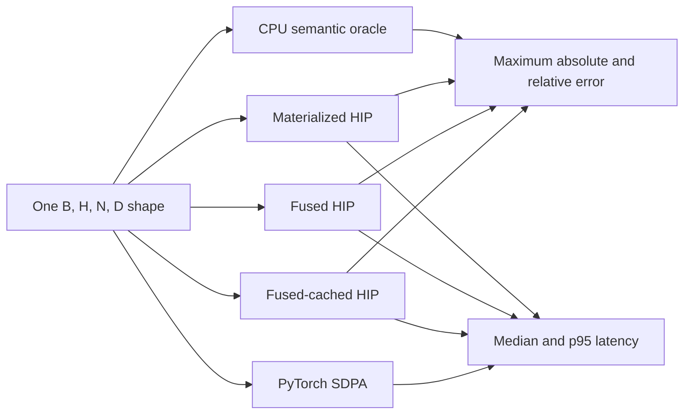
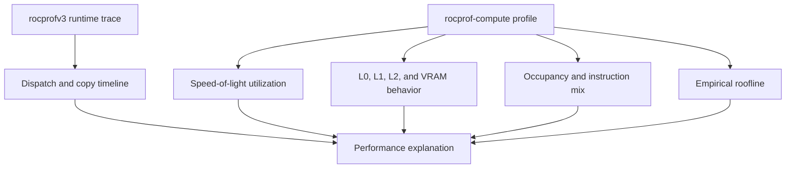

# Benchmarking Protocol

## Comparison matrix



Use the same shape, mask mode, data type, warmup count, and timed iteration
count for every performance comparison. The C++ kernels currently share seeded
inputs and compare directly with the CPU oracle. PyTorch SDPA is currently a
performance baseline; cross-process tensor parity will be added with the custom
operator.

## Required environment record

Each C++ CSV row includes:

- UTC timestamp and Git commit SHA
- Device name and GPU architecture
- HIP runtime and driver version
- Algorithm, type, shape, mask mode, and seed
- Warmup and timed iteration count
- Mean, median, p95, minimum, and maximum latency
- Estimated throughput and logical bandwidth
- Workspace bytes and correctness error

## Standard runs

Start with short correctness-checked shapes:

```bash
python3 scripts/run_sweep.py \
  --executable ./build/wave_bench \
  --sequences 128,256 \
  --dimensions 64,128 \
  --iterations 100 \
  --output out/rx9070xt.csv
```

Append the PyTorch FP32 baseline using the identical shape matrix:

```bash
python3 scripts/benchmark_pytorch.py \
  --sequences 128,256 \
  --dimensions 64,128 \
  --iterations 100 \
  --output out/rx9070xt.csv \
  --append
```

Generate the comparison table:

```bash
python3 scripts/summarize.py out/rx9070xt.csv --output out/RESULTS.md
```

Scale to 512, 1024, 2048, and 4096 only after the small shapes pass. Perform at
least three complete sweeps after clocks and temperatures stabilize. Retain all
raw CSV files; do not copy only the best trial into the repository.

## Profiler evidence



For `fused` versus `fused-cached`, the first question is whether caching Q
reduces vector-memory traffic enough to offset added LDS use. Report cache and
occupancy evidence alongside latency; elapsed time alone cannot establish the
cause.

