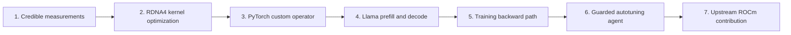

# Roadmap

## Milestone 1: Credible measurements

- [x] CPU reference and causal semantics
- [x] Materialized and online-softmax HIP kernels
- [x] Query-cached fused experiment
- [x] Median, p95, min, max, device, runtime, and revision metadata
- [x] PyTorch SDPA performance harness
- [x] Compile all HIP variants for `gfx1201`
- [x] Publish RX 9070 XT raw measurements
- [x] Publish runtime trace and profiler comparison

Exit criterion: all small shapes pass correctness and a checked-in report
explains the baseline using measurements rather than estimates.

Met by [results/rx9070xt-fp32.md](../results/rx9070xt-fp32.md). The measurements
overturned the assumption this milestone was built on: the fused path is slower
than the materialized baseline at every shape, and the cached-Q variant is within
noise of the plain fused one.

## Milestone 2: RDNA4 optimization

- [x] Tile queries so a block serves several query rows instead of one
- [x] Cache and tile K/V through LDS
- [x] Replace block reductions with measured wave-level reductions
- [ ] Size the LDS tile to the actual head dimension (dynamic-LDS experiment rejected; see optimization notes)
- [ ] Add aligned vector loads and tail handling
- [ ] Add FP16 and BF16 inputs with FP32 accumulation
- [ ] Evaluate WMMA score tiles on RDNA4
- [ ] Add shape-aware deterministic autotuning

Exit criterion: each accepted optimization has before/after profiler evidence
and no correctness regressions across the test matrix.

The `tiled` kernel delivers the first three items together, since they address a
single bottleneck and are not separable within one kernel. Measured at 2.63x to
7.25x over `fused-cached`, with before/after traces in
[results/rx9070xt-fp32.md](../results/rx9070xt-fp32.md). It is slower than the
materialized baseline at `N=128 D=64`, which is recorded rather than hidden.

## Milestone 3: PyTorch custom operator

- [ ] Accept contiguous PyTorch device tensors without host copies
- [ ] Register forward and meta implementations
- [ ] Support causal MHA and GQA shapes
- [ ] Compare outputs and gradients against PyTorch SDPA
- [ ] Package reproducibly for the supported ROCm/PyTorch pair

## Milestone 4: LLM inference

- [ ] Integrate a small Llama-style attention module
- [ ] Separate prefill and single-token decode benchmarks
- [ ] Add append-KV and paged KV-cache paths
- [ ] Report tokens per second, tail latency, and peak VRAM

## Milestone 5: Training and post-training

- [ ] Implement and validate attention backward
- [ ] Run a small LoRA/SFT workload
- [ ] Profile forward, backward, optimizer, and data movement separately
- [ ] Add a rollout-generation study representative of GRPO workloads

## Milestone 6: Agentic autotuning

- [ ] Define a constrained tile and launch-parameter search space
- [ ] Reject any candidate that fails correctness
- [ ] Require repeated statistically meaningful measurements
- [ ] Store every proposal, compiler result, profile, and decision
- [ ] Allow promotion only through a reviewed configuration file

The tuning agent will not initially rewrite arbitrary kernel code. Constraining
its actions makes experiments reproducible and keeps correctness gating explicit.
