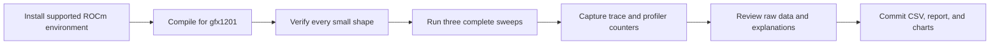

# Results

No RX 9070 XT performance results have been published yet. This is intentional:
the current development environment can validate the CPU and reporting paths,
but does not have the HIP SDK installed.

A result is publishable only when it includes:

- Raw CSV data from all custom variants and PyTorch SDPA
- At least three complete trials for the reported matrix
- Maximum absolute and relative correctness errors
- Commit SHA, driver, ROCm runtime, architecture, and test configuration
- Median and p95 latency rather than a selected best iteration
- A profiler-backed explanation of the main bottleneck
- Explicit disclosure of clock, power, and thermal settings

The first report will compare `materialized`, `fused`, and `fused-cached` at
sequence lengths 128, 256, 512, and 1024 with dimensions 64 and 128. Larger
shapes follow after correctness and memory behavior are understood.

